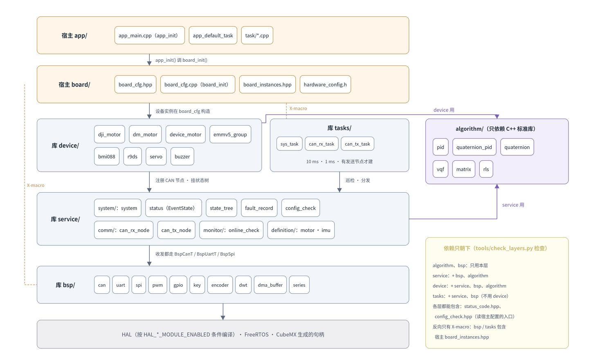
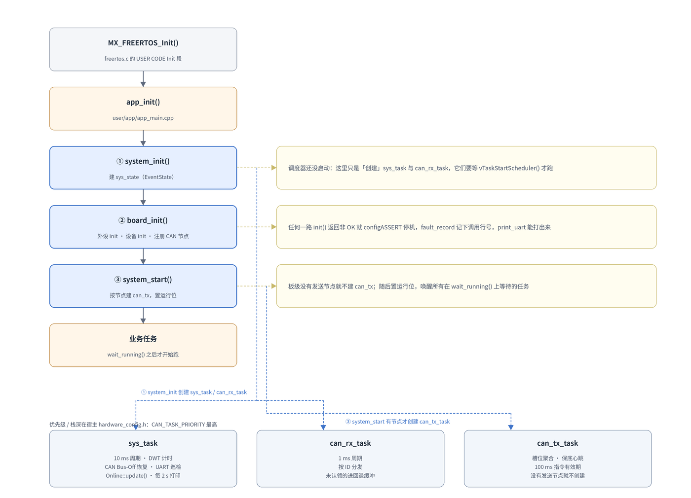

# 代码层索引（code/）

[← README](../../README.md) · [接入指南](../接入指南.md) · [常用接口](../常用接口.md) · [编辑器配置](../编辑器配置.md)

源码在仓库根目录的 **`code/`** 下，按依赖关系分五层（`service/`、`device/` 再按用途分子目录）。本文是入口：先看分层图和依赖矩阵找到层，
再进该层的文档看文件表与接口。



> 矢量版：[layers.svg](../img/layers.svg)（可无限放大，适合打印）。
> 两张图都由 `tools/draw_diagrams.py` 生成，改坐标后重跑即可。

---

## 1. 六层各管什么

| 目录 | 一句话职责 | 不负责 | 文档 |
| --- | --- | --- | --- |
| `code/bsp/` | 一个外设怎么初始化、怎么收发（CAN / UART / SPI / PWM / GPIO / Key / Encoder / DWT） | 帧格式、设备语义、重连策略 | [bsp.md](bsp.md) |
| `code/service/` | `system/`：库入口、系统状态（EventState）、故障记录；`comm/`：CAN 收发节点；`monitor/`：在线检查；`definition/`：电机 / IMU 数据定义 | 具体设备协议 | [service.md](service.md) |
| `code/device/` | `motor/`：DJI 电机、直流电机、Emm_V5（含纯编解码的 `emmv5_protocol`，见 [protocol.md](protocol.md)）；`sensor/`：BMI088；`remote/`：R9DS；`actuator/`：舵机、蜂鸣器 | 硬件时序细节（交给 bsp） | [device.md](device.md) |
| `code/algorithm/` | PID、四元数 PID、VQF、矩阵、RLS | 与硬件无关，不碰 HAL | [algorithm.md](algorithm.md) |
| `code/tasks/` | 三个库任务的任务体：sys / can_rx / can_tx | 任务创建（在 service/system/system.cpp） | [tasks.md](tasks.md) |

包含路径只有 `code/`，一律写全子目录：`#include "bsp/bsp_uart.hpp"`、`#include "device/motor/dji_motor.hpp"`。

宿主侧的 `user/app`、`user/board`、`user/module` 不在库里，见 [接入指南 §4.2](../接入指南.md#42-userboard)。

---

## 2. 依赖矩阵

行 = 谁，列 = 依赖谁；`●` 直接 include，`○` 通过 X-macro 清单反向依赖。

|  | board | bsp | service | device | algorithm | HAL/FreeRTOS |
| --- | --- | --- | --- | --- | --- | --- |
| **app（宿主）** | ● |  | ● | ○ |  |  |
| **board（宿主）** |  | ● |  | ● |  | ● |
| **tasks** | ○ | ● | ● |  |  | ● |
| **device** |  | ● | ● |  | ● | ● |
| **service** |  | ● |  |  |  | ● |
| **bsp** | ○ |  |  |  |  | ● |
| **algorithm** |  |  | ● |  |  |  |

两条硬规则：

1. **箭头只朝下**：上层依赖下层，下层永远不 include 上层。
2. 唯一的例外是 `○`：`bsp/` 和 `tasks/` 会 include 宿主的 `board_instances.hpp`，
   靠 X-macro 在编译期把「板子上有哪几个实例」展开进来——没有运行时登记表。
   这也是为什么漏写实例不会报错，只会「中断不分发」（见 [bsp.md](bsp.md#实例清单x-macro)）。

跨层依赖（不在上面矩阵的相邻格里）：

- `app → service`：`system_init()` / `system_start()` 直接在 `app_init()` 里调
- `board → bsp`：外设实例在 `board_cfg.hpp` 里构造
- `device → bsp`：初始化与收发都走 `BspCanT` / `BspUartT` / `BspSpi`
- `device → service`：向 `CanRxNodeT` / `CanTxNodeT` 注册自己
- `tasks → bsp`：`sys_task` 做 Bus-Off 恢复与串口巡检

---

## 3. 启动顺序



> 矢量版：[startup.svg](../img/startup.svg)

```
MX_FREERTOS_Init()            freertos.c 的 USER CODE Init 段
  └─ app_init()               user/app/app_main.cpp
       ├─ ① system_init()     建 sys_state，创建 sys_task / can_rx_task
       ├─ ② board_init()      外设 init、设备 init、注册 CAN 节点
       └─ ③ system_start()    有发送节点才建 can_tx_task，置运行位
```

顺序是硬约束：`board_init()` 里注册的 CAN 节点必须**在 `system_init()` 之后**（要用 `sys_state`）、
**在 `system_start()` 之前**（`can_tx_task` 按已注册节点决定建不建）。

三个任务的周期与职责见 [tasks.md](tasks.md)。

---

## 4. 建议的阅读顺序

排查问题时的最短路径：

| 想知道 | 看哪里 |
| --- | --- |
| 某个外设为什么收不到数据 | [bsp.md](bsp.md) 的「实例清单」与「常见坑」 |
| 电机不动 / 报文不对 | [device.md](device.md) → [protocol.md](protocol.md) |
| 系统起不来、卡在 `wait_running()` | [service.md](service.md) 的 EventState 与 [启动顺序](#3-启动顺序) |
| 为什么会有 10 ms / 1 ms 这种周期 | [tasks.md](tasks.md) |
| PID 输出怪 | [algorithm.md](algorithm.md) |

新增代码前先确认「放哪一层」：能只依赖 HAL 的放 `bsp`，涉及具体设备协议的放 `device`，
纯数学放 `algorithm`，跨设备的调度与状态放 `service`。
