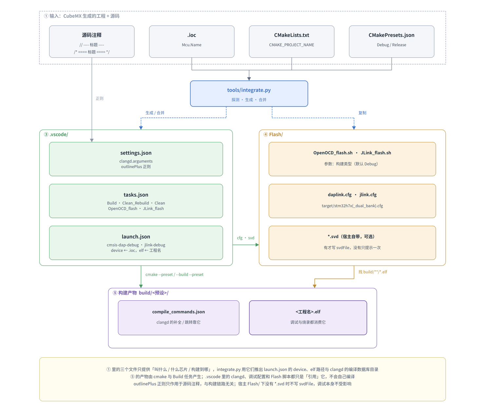

# 编辑器配置（.vscode）

[← README](../README.md) · [接入指南](接入指南.md) · [模板说明](../templates/README.md)

`integrate.py` 会把 `templates/vscode/` 的三个文件生成 / 合并进宿主 `.vscode/`：宿主没有就整体生成，
已经有了就只补缺失的键和任务，原有内容与注释都保留。本文说明每一项是干什么的，重点讲 outline++ 的分区正则。

除 `.vscode/` 之外，它还会在**宿主根目录**补两个文件（都已存在时不覆盖，只校对内容）：

| 文件 | 内容 | 为什么要有 |
| --- | --- | --- |
| `.clang-format` | 库根目录那份风格文件（`BasedOnStyle: LLVM` + 本项目改动） | 团队/CI 格式化口径统一；带 `Language: Cpp`，只作用于 C++，**不碰 CubeMX 生成的 `Core/Src/*.c`** |
| `.clangd` | `CompilationDatabase`（指向该预设的 `build/<预设>`）+ `-Wno-unknown-warning-option`，再加一段 `If: PathMatch: .*templates/.*` 把库的 `templates/` 排除在索引与诊断之外 | clangd 不会自己去找 `compile_commands.json`；缺了编译数据库，Cortex-M 的 `-mcpu` / 系统头全丢，头文件一路标红。而 `templates/` 不参与构建、又和宿主有同名文件，不排除会互相干扰补全与跳转 |

`templates/` 那一段是单独的 YAML 文档（`---` 分隔），作用范围只限模板目录：

```yaml
If:
  PathMatch: .*templates/.*
CompileFlags:
  CompilationDatabase: None   # 不用宿主的编译数据库
Index:
  Background: Skip            # 不进后台索引
Diagnostics:
  Suppress: '*'               # 不报诊断
```

只想临时看模板里的补全，把它注释掉即可；改完 clangd 会自动重载配置。

> **`--query-driver` 不能写进 `.clangd`。** 它是 clangd 自己的命令行参数，写进 `CompileFlags`
> 会被当成编译器参数转给 `arm-none-eabi-gcc`，报
> `Unknown argument: '--query-driver=...'`（诊断码 `drv_unknown_argument`）。
> 正确位置是**启动 clangd 的地方**：VS Code 里就是 `settings.json` 的 `clangd.arguments`；
> Neovim / Emacs / 命令行则在启动参数里加 `--query-driver=/path/to/arm-none-eabi-*`。

`.clangd` 与 `settings.json` 的 `clangd.arguments` 有重叠（都指定编译数据库）：内容保持一致即可。
换构建预设后，要么手改 `.clangd` 里的路径，要么删掉它重跑 `integrate.py`。



> 图里 ① 输入 → ② integrate.py → ③ `.vscode` / ④ `Flash/` → ⑤ 构建产物 的关系；
> 矢量版 [img/toolchain.svg](img/toolchain.svg)。

---

## 1. settings.json 一览

| 设置 | 作用 |
| --- | --- |
| `clangd.arguments` | `--compile-commands-dir=build/Debug` 指定编译数据库；`--query-driver=**/arm-none-eabi-*` 让它读交叉工具链的内置宏与系统头（**这一项只能写在这里**） |
| `cmake.useCMakePresets` | 用 `CMakePresets.json` 里的 Debug / Release，而不是自己猜构建目录 |
| `cortex-debug.variableUseNaturalFormat` | 调试时变量按自然类型显示（寄存器位域不会显示成十进制大数） |
| `VsCodeTaskButtons.tasks` | 状态栏按钮，`task` 字段必须等于 `.vscode/tasks.json` 里的 `label` |
| `outlinePlus.regionBoundaryPatternByLanguageId` | 用正则把注释识别成 Outline 里的区块，见 §3 |

`tasks.json` / `launch.json` 里的构建、烧录、调试配置见 [接入指南 §3](接入指南.md#3-自动接入)。

---

## 2. outline++ 解决什么问题

VS Code 自带的 Outline（大纲）只认识**语法结构**：函数、类、结构体、宏。源码里大量用注释分区，
这些注释在默认 Outline 里**不会出现**，文件一长只能靠搜索找位置。

**Outline++**（设置前缀 `outlinePlus`）让 Outline 额外识别「注释写的区域」，靠两条正则：

| 键 | 含义 |
| --- | --- |
| `startRegex` | 一段从哪一行开始；**第 1 个捕获组就是区域名** |
| `endRegex` | 一段到哪一行结束 |

配置放在 `outlinePlus.regionBoundaryPatternByLanguageId` 下，按 VS Code 的 **languageId** 分开写：
`c` 对应 `.c` / `.h`，`cpp` 对应 `.cpp` / `.hpp`（`.h` 默认语言模式是 C，所以两个键都要配）。

---

## 3. 规则：一对注释包住一段

只认这一种写法，长度固定，必须成对，像大括号：

```cpp
/* ==================== 总线 ==================== */
inline BspCanT<16, 16> bsp_can1(
    {.hfdcan = &hfdcan1, .name = "CAN1"});
/* ==================== */
```

```jsonc
"outlinePlus.regionBoundaryPatternByLanguageId": {
    "c": {
        "startRegex": "^\\s*/\\* ={20} (.+) ={20} \\*/\\s*$",
        "endRegex":   "^\\s*/\\* ={20} \\*/\\s*$"
    },
    "cpp": {
        "startRegex": "^\\s*/\\* ={20} (.+) ={20} \\*/\\s*$",
        "endRegex":   "^\\s*/\\* ={20} \\*/\\s*$"
    }
}
```

起始行和结束行的区别只有一处：**起始行有两个等号段（中间夹标题），结束行只有一个等号段**。

| 片段 | 含义 |
| --- | --- |
| `^\s*` | 行首锚定，允许缩进（写成行尾注释就不匹配） |
| `/\* ={20} ` | 字面量 `/* ` + **正好 20 个 `=`** + 一个空格 |
| `(.+)` | **捕获组 1 = 标题**（只有 `startRegex` 有这一段，所以结束行不会被当成起始行） |
| ` ={20} \*/\s*$` | 空格 + 20 个 `=` + ` */` + 行尾（允许尾随空格） |

### 为什么写 `{20}` 而不是 `{16,}`

固定长度 ⇒ 19 个或 21 个等号都**不匹配**，标题既不会混进 `=`，也不会被截断。
要改长度就同时改三处（起始行两段 + 结束行一段）。

### 三条写法约定（正则管不了，靠写代码遵守）

| 约定 | 违反的后果 |
| --- | --- |
| **必须成对**：`/* ==== 标题 ==== */` … `/* ==== */` | 漏了收尾，这一段会一直延续到下一段的开头 |
| **不能嵌套**：一段里面不许再开一段 | 遇到内层开始行，外层就算结束，后面那个收尾会对到别处 |
| **收尾唯一**：一段只有一个 `/* ==== */` | 多出来的收尾会把紧跟其后的内容划成空段 |

> 本仓库（库的 `code/`、`templates/user/`）与宿主工程的 `user/` 已按这个格式全部统一：
> 原来混用的 `// ---------------- 标题 ----------------` 与不带收尾的 `/* ==== 标题 ==== */`
> 都已改成上面这一种。

### JSON 里的反斜杠

`"\\s"` 才表示正则的 `\s`。写成 `"\s"` 要么直接报错，要么反斜杠被吞、正则变成 `s`，永远匹配不上。
`\d`、`\w`、`\.` 同理。

---

## 4. 给别的语言加

同一套规矩，只换注释前缀（以 Python / CMake 的 `#` 为例）：

```jsonc
"python": {
    "startRegex": "^\\s*# ={20} (.+) ={20}\\s*$",
    "endRegex":   "^\\s*# ={20}\\s*$"
},
"cmake": {
    "startRegex": "^\\s*# ={20} (.+) ={20}\\s*$",
    "endRegex":   "^\\s*# ={20}\\s*$"
}
```

规则不变：固定 20 个等号、必须有收尾、不许嵌套。

---

## 5. 排查

| 现象 | 检查 |
| --- | --- |
| Outline 里没有区块 | ① 有没有 `/* ==== */` 收尾；② 等号是不是正好 20 个；③ 语言模式是 `C` 还是 `C++`（两个键都要配） |
| 只有部分文件有区块 | 那些文件的分隔符 / 等号个数不一样，或者漏了收尾 |
| 区域名里多了 `=` | 等号个数不是 20（`{20}` 是固定长度，多一个少一个都不匹配） |
| 区块提前结束 | 段内出现了单独一行 `/* ==== */`（它是收尾，不是分隔线） |
| 什么都不生效 | `settings.json` 里正则被写成了单反斜杠 `\s`，必须是 `\\s` |
| 改完没反应 | 命令面板 → `Developer: Reload Window` |
